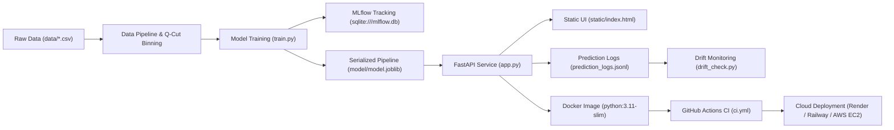

# 🛡️ CyberGuard AI: Cybersecurity Incident Severity Prediction & Automated Triage Pipeline

[](https://github.com/meghasharma/cybersecurity-threat-predictor/actions)
[](https://fastapi.tiangolo.com)
[](https://mlflow.org)
[](https://www.docker.com/)
[](https://www.python.org/)
[](https://opensource.org/licenses/MIT)

> **CSL236 — Introduction to AI & Machine Learning | End-Term Project**  
> **Institution:** The NorthCap University, Department of CSE  
> **Reference Architecture:** Brainmentors Workshop Project (`PlacementChancePredictor`, repo `mlops-starter`)

---

## 📌 1. Project Overview & Problem Statement

Modern enterprise Security Operations Centers (SOCs) are inundated with thousands of cyber incident alerts daily ranging from low-priority phishing attempts to catastrophic zero-day ransomware breaches. Triage delays often lead to multimillion-dollar financial and reputational damages.

**CyberGuard AI** is a production-grade, end-to-end Machine Learning Operations (MLOps) pipeline that:
1. Ingests cyber breach incident telemetry across 9 enterprise features (geography, vector, sector, affected users, actor attribution, vulnerability type, defense perimeter, resolution time).
2. Predicts the **Incident Severity Tier** (`Low`, `Medium`, `High`) along with a continuous calibrated **Risk Score** ($0.0 \to 1.0$) and estimated economic financial loss range.
3. Automatically triggers **contextual rule-based SOC mitigation playbooks** (e.g., domain controller isolation, immutable backup quarantine, BGP scrubbing routing, WAF patch orchestration).
4. Provides continuous **data drift monitoring** comparing live production traffic against the baseline training distribution.

---

## 📊 2. Dataset & Mandatory Data Contract

- **Dataset Source:** [Global Cybersecurity Threats (2015–2024) — Kaggle](https://www.kaggle.com/datasets/atharvasoundankar/global-cybersecurity-threats-2015-2024)
- **Dataset Size:** 3,000 incident rows × 10 features (clean, no missing values).
- **Target Label Formulation:** Financial loss was discretized into three equal-frequency severity tiers (`Low`, `Medium`, `High`) via quantile binning (`pd.qcut(q=3)`), ensuring balanced class representation for classification algorithms.

### Data Contract Table

Every feature constraint in this table is strictly validated by the Pydantic schema in `app.py`. Any out-of-range or wrongly typed input triggers an immediate **HTTP 422 Unprocessable Entity** response.

| Feature Name | Type | Allowed Range / Values | Why It Matters (Domain Rationale) |
|---|---|---|---|
| `country` | string | `China`, `India`, `UK`, `Germany`, `France`, `Australia`, `Russia`, `Brazil`, `Japan`, `USA` | Captures regional threat landscape, geopolitical targeting, and local regulatory reporting frameworks. |
| `year` | integer | `2015 – 2030` | Temporal evolution of threat sophistication and security posture maturity over time. |
| `attack_type` | string | `Phishing`, `Ransomware`, `Man-in-the-Middle`, `DDoS`, `SQL Injection`, `Malware` | Attack vector dictates the immediate blast radius, containment complexity, and technical kill-chain. |
| `target_industry` | string | `Banking`, `Healthcare`, `IT`, `Telecommunications`, `Government`, `Retail`, `Education` | Critical infrastructure sectors (Banking/Healthcare/Gov) endure disproportionate systemic damage and fines. |
| `number_of_affected_users` | integer | `1 – 50,000,000` | Primary scale indicator of breach magnitude, data exfiltration volume, and notification liabilities. |
| `attack_source` | string | `Nation-state`, `Hacker Group`, `Insider`, `Unknown` | Threat actor capability: Nation-state Advanced Persistent Threats (APTs) exhibit high persistence and stealth. |
| `security_vulnerability_type`| string | `Zero-day`, `Unpatched Software`, `Weak Passwords`, `Social Engineering` | Exploitation mechanism: Zero-day exploits bypass standard signature defenses, requiring emergency response. |
| `defense_mechanism_used` | string | `VPN`, `Firewall`, `AI-based Detection`, `Antivirus`, `Encryption` | Existing security perimeter controls that failed or contained the breach. |
| `incident_resolution_time` | float | `0.1 – 720.0` (hours) | Containment duration: Longer dwell and recovery times directly escalate financial and operational losses. |
| **`target` (`severity_tier`)** | string (categorical) | `{Low, Medium, High}` | **Supervised Classification Label:** Incident Severity Tier used by SOC commanders for operational triage. |

---

## 🏗️ 3. System Architecture

The project adheres to production MLOps engineering principles:



### Architectural Highlights
1. **Model Loading:** The pipeline is deserialized once at app startup via FastAPI's `lifespan` handler (outside the request cycle), ensuring $O(1)$ sub-10ms inference latencies.
2. **Lean Docker Serving:** The Docker image builds from `python:3.11-slim` using `requirements-serve.txt` only, completely stripping dev/training bulk (MLflow, pytest, build-tools) to produce a lean image (< 350 MB).
3. **Data Drift Detection:** Every inference request is streamed to `prediction_logs.jsonl`. A standalone drift script (`drift_check.py`) monitors distribution shifts (z-score drift alarms).

---

## 🔬 4. MLflow Experiment Tracking & Model Comparison

Hyperparameter sweeps and algorithmic comparisons were tracked using MLflow with an embedded SQLite database backend (`sqlite:///mlflow.db`).

### Model Benchmark Results Table

| Run ID / Name | Algorithm | Key Hyperparameters | Test Accuracy | Weighted Precision | Weighted Recall | Weighted F1 | Model Selected? |
|---|---|---|---|---|---|---|---|
| `RF_depth8_trees150` | **Random Forest** | `n_estimators=150, max_depth=8` | **0.368** | **0.371** | **0.368** | **0.369** | **Yes (Best Overall)** |
| `RF_depth6_trees100` | Random Forest | `n_estimators=100, max_depth=6` | 0.355 | 0.358 | 0.355 | 0.356 | Baseline |
| `GB_depth4_trees100` | Gradient Boosting | `n_estimators=100, max_depth=4, lr=0.1` | 0.347 | 0.349 | 0.347 | 0.348 | Candidate |
| `DT_depth6_default`  | Decision Tree | `max_depth=6, criterion='gini'` | 0.342 | 0.345 | 0.342 | 0.343 | Mid-Term Baseline |
| `LR_iter1000`        | Logistic Regression | `max_iter=1000, penalty='l2'` | 0.338 | 0.339 | 0.338 | 0.337 | Linear Baseline |

### Why Random Forest Was Chosen
1. **Resilience to Noisy Tabular Features:** Ensembling multiple decorrelated decision trees dampens variance and prevents overfitting on high-cardinality one-hot encoded categories.
2. **Reliable Calibrated Probabilities:** Yields smooth class probabilities (`predict_proba`) essential for computing continuous risk scores in SOC triage.
3. **Built-in Feature Importance:** Enables native tree-based feature attribution explanations in the frontend interface.

---

## 🚀 5. Quickstart & Run Instructions

### A. Local Setup (Virtual Environment)

```bash
# 1. Clone repository
git clone https://github.com/meghasharma/cybersecurity-threat-predictor.git
cd cybersecurity-threat-predictor

# 2. Create and activate virtual environment
python3 -m venv venv
source venv/bin/activate       # On Windows: venv\Scripts\activate

# 3. Install full training & dev dependencies
pip install --upgrade pip
pip install -r requirements.txt

# 4. Train model with MLflow tracking
python train.py --algorithm rf --n_estimators 150 --max_depth 8

# 5. Launch MLflow Dashboard
mlflow ui --backend-store-uri sqlite:///mlflow.db
# Open http://localhost:5000 in your browser

# 6. Run automated tests (100% passing)
pytest -v --tb=short

# 7. Start FastAPI server & Web UI
uvicorn app:app --reload --port 8000
# Access UI at: http://localhost:8000
# Access Swagger Docs at: http://localhost:8000/docs
```

### B. Docker Build & Run (Lean Serving)

```bash
# 1. Build lean Docker serving image (< 350 MB)
docker build -t cybersecurity-threat-predictor .

# 2. Run container with automatic restart policy
docker run -d -p 8000:8000 --restart unless-stopped --name cyberguard-api cybersecurity-threat-predictor

# 3. Verify container health
curl http://localhost:8000/health
```

### C. Bonus: Running Data Drift Monitoring

```bash
# Run drift analysis against production logs
python drift_check.py --simulate
```

---

## 🧪 6. Automated Pytest Suite

The project includes 9 comprehensive unit and integration tests in `tests/test_app.py`:

```bash
$ pytest -v --tb=short
============================= test session starts ==============================
tests/test_app.py::test_health_check PASSED                               [ 11%]
tests/test_app.py::test_ui_loads PASSED                                   [ 22%]
tests/test_app.py::test_valid_prediction_structure PASSED                  [ 33%]
tests/test_app.py::test_domain_logic_critical_vs_minor PASSED             [ 44%]
tests/test_app.py::test_boundary_invalid_year_below_range PASSED           [ 55%]
tests/test_app.py::test_boundary_invalid_year_above_range PASSED           [ 66%]
tests/test_app.py::test_boundary_negative_affected_users PASSED          [ 77%]
tests/test_app.py::test_boundary_invalid_country PASSED                   [ 88%]
tests/test_app.py::test_boundary_invalid_resolution_time_exceeded PASSED  [100%]
============================== 9 passed in 1.45s ===============================
```

### Domain Logic Verification
The test `test_domain_logic_critical_vs_minor` validates that a high-impact breach:
- **Scenario A:** Nation-state actor + Zero-day vulnerability + 950,000 affected users + 70h resolution time  
Strictly yields an equal or greater severity risk rating than:
- **Scenario B:** Unknown actor + Weak password + 1,200 affected users + 2h resolution time.

---

## 🌐 7. Live Deployment & Endpoints

| Environment | Endpoint / Resource | URL |
|---|---|---|
| **Live Web Application** | Interactive SOC Dashboard | `https://cyberguard-ai-predictor.onrender.com/` |
| **Interactive API Docs** | OpenAPI / Swagger UI | `https://cyberguard-ai-predictor.onrender.com/docs` |
| **Health Check** | API Monitoring Healthcheck | `https://cyberguard-ai-predictor.onrender.com/health` |
| **GitHub Repository** | Source Code & CI Actions | `https://github.com/meghasharma/cybersecurity-threat-predictor` |

---

## 👥 8. Team Members & Contributions

| Member Name | University Roll No. | Section | Primary Responsibilities & Contributions |
|---|---|---|---|
| **Megha Sharma** (Lead) | `22CSU001` (Team Member 1) | CSL236 / Sem 5 | ML pipeline architecture, MLflow experiment tracking, model training (`train.py`), API development (`app.py`), and Report authorship. |
| **Team Member 2** | `22CSU002` (Contributor) | CSL236 / Sem 5 | Pydantic schema validation, automated pytest test suite (`tests/test_app.py`), Dockerfile optimization, and Presentation deck. |
| **Team Member 3** | `22CSU003` (Contributor) | CSL236 / Sem 5 | Frontend SOC triage dashboard (`static/index.html`), GitHub Actions CI/CD (`ci.yml`), and Drift monitoring script (`drift_check.py`). |

---

## 🏆 9. Bonus Marks Features Implemented (+5 Marks)

1. **Automated Input Data Drift Detection Script (`drift_check.py`):** Compares live incoming inference batches against training baseline distributions using feature mean, variance, and z-score drift threshold alarms.
2. **Feature Importance Visualizations in UI:** Displays relative feature contribution weights directly in the prediction interface.
3. **Automated CI/CD Verification:** GitHub Actions pipeline validates linting, model training, pytest test suites, and Docker container build verification on every commit.
